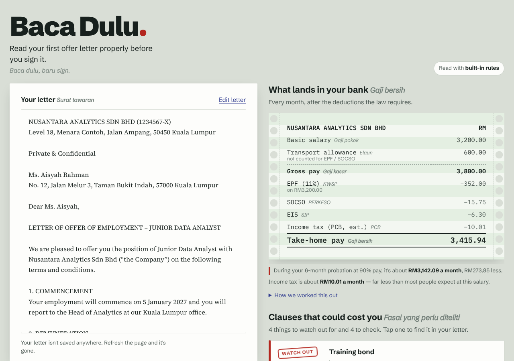

# Baca Dulu

**Read your first offer letter properly before you sign it.**
Paste a Malaysian job offer letter and see, on one screen:

- **What lands in your bank** — gross pay minus EPF, SOCSO, EIS and estimated income tax (PCB), on a green-bar payslip.
- **Clauses that could cost you** — training bonds, reduced-pay probation, uneven notice periods, allowance-heavy pay, no overtime, non-competes, transfers, short deadlines — each quoting and highlighting the exact sentence in your letter.
- **What to ask HR** — polite questions built from your letter's flags, copied as a ready-to-send email.

*Baca dulu* is Malay for "read first".



Built for Devpost's [Build With AI: Basics](https://learn-ai-basics.devpost.com/) with the [Devpost Learn Skill Pack](https://github.com/challengepost/learn-ai-basics). Planning docs are in [`devpost/`](devpost/): [scope](devpost/scope.md), [PRD](devpost/prd.md), [spec](devpost/spec.md), [build checklist](devpost/checklist.md).

## Try it

Requires Node.js 20+.

```bash
npm install
npm run dev
```

Open <http://localhost:3000>, click **Try a sample letter**, then **Decode letter**.

The sample letter is fictional (*Nusantara Analytics Sdn Bhd*). No API key is needed: letters are read with built-in rules written for Malaysian offer letters.

### Optional: AI reading with Gemini

```bash
cp .env.example .env.local
# put your key from https://aistudio.google.com/apikey in GEMINI_API_KEY
npm run dev
```

With a key, the letter is read by Gemini (`gemini-3.8-flash` by default, change with `GEMINI_MODEL`). Every quote the AI returns is checked against the letter, and any quote that isn't really there is dropped. Built-in rules still run, so a clause the AI misses is still caught. If the AI call fails, the app falls back to built-in rules and the tag at the top says so.

### Tests

```bash
npm test
```

42 unit tests cover the statutory arithmetic (checked against hand calculations and PERKESO band values), the salary reader, every clause detector on the sample letter and on a fair letter, the HR questions, and the AI fallback paths with a mocked Gemini response.

## How the numbers are worked out

| Line | Rule used |
| --- | --- |
| EPF | 11% employee share on basic + allowances, except travel/transport-type allowances; EPF table bands (RM20 up to RM5,000), rounded up to the ringgit |
| SOCSO | 0.5% employee share of the RM100 wage band's midpoint, wages capped at RM6,000 (max RM29.75) |
| EIS | 0.2% employee share, same bands and cap (max RM11.90) |
| PCB | Estimate: annual gross − RM9,000 individual relief − EPF relief (max RM4,000) − SOCSO/EIS relief (max RM350), YA2025 resident tax bands, RM400 rebate if chargeable income ≤ RM35,000, divided by 12 |

Assumes a Malaysian resident employee under 60, single, with no other reliefs. Your employer's actual PCB uses LHDN's monthly formula and may differ slightly.

**Estimates only — not legal, tax or financial advice.** Check figures with [EPF](https://www.kwsp.gov.my), [PERKESO](https://www.perkeso.gov.my) and [LHDN](https://www.hasil.gov.my).

## How it's built

- **Next.js 16 + React 19 + TypeScript**, plain CSS. One page (`app/page.tsx`) and one API route (`app/api/decode/route.ts`).
- `lib/statutory.ts` — EPF, SOCSO, EIS, PCB arithmetic.
- `lib/salary.ts` — finds basic salary and fixed allowances.
- `lib/rules.ts` — clause detectors, each returning the exact character range of its quote.
- `lib/ai.ts` — optional Gemini reader with JSON schema, validation and quote checking.
- `lib/questions.ts` — turns flags into questions for HR.
- Fonts (Schibsted Grotesk, Source Serif 4, IBM Plex Mono) are bundled via Fontsource, so it works offline.

## Privacy

Letters are never stored. With built-in rules, the letter is only sent to Baca Dulu's own server to be read, and it's discarded straight after. With a Gemini key set, the letter text is also sent to Google's Gemini API when you click Decode.

## Limits

- English letters, pasted as text (no PDF or photo upload yet).
- Built-in rules can miss unusually worded clauses; the "We checked" list shows what was looked for.
- Not a substitute for advice from a lawyer, HR professional or LHDN.

## Licence

[MIT](LICENSE)
